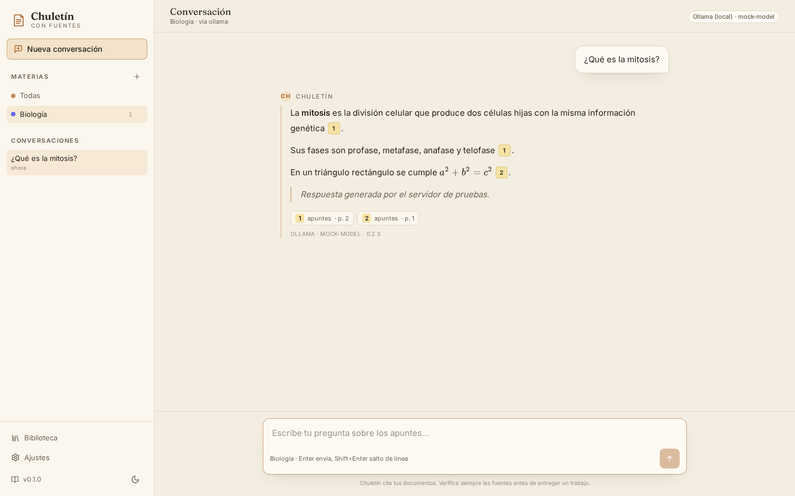
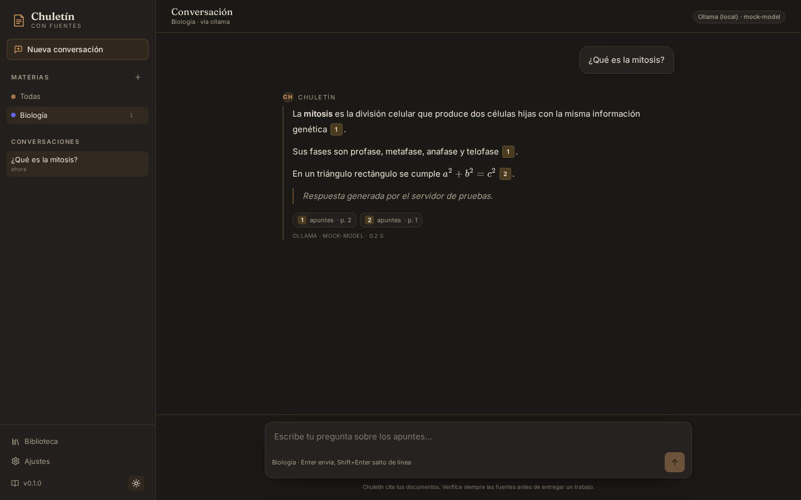
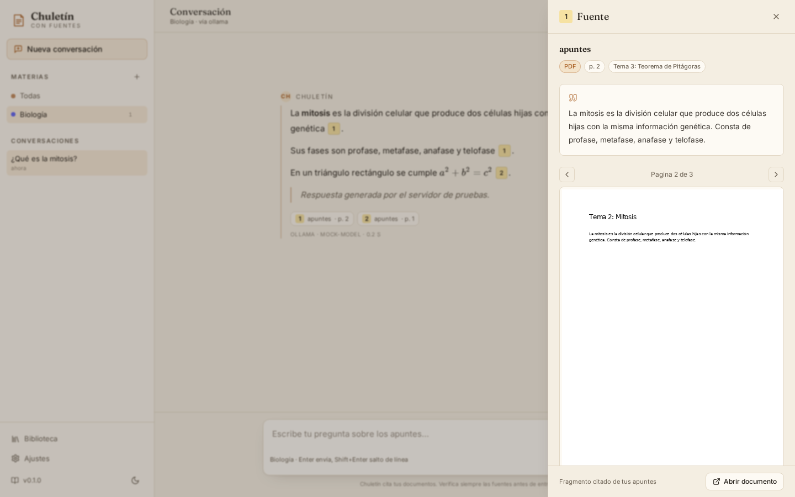

# Chuletín

> Tus apuntes, con fuentes verificables.

**Chuletín** es una aplicación local de estudio que responde usando **tus
propios documentos** (PDF, Word, PowerPoint, páginas web, vídeos de YouTube y
fotos de apuntes) y **cita de dónde sale cada afirmación**: documento, página o
minuto exacto.

No es un chatbot que "sabe de todo": es un asistente que se limita a lo que tú
le has dado y lo demuestra. Si la respuesta no está en tus apuntes, lo dice.

## Estado

MVP en desarrollo activo:

- [x] Biblioteca por materias e ingesta de documentos
- [x] Extracción con páginas (PDF), diapositivas (PPTX), estilos (DOCX), webs y YouTube
- [x] Índice híbrido local (FTS5 + embeddings)
- [x] Chat con respuestas en streaming y citas clicables
- [x] Interfaz web con tema claro y oscuro, visor de PDF y panel de fuentes
- [ ] Resúmenes y esquemas
- [ ] Flashcards con repaso espaciado
- [ ] Cuestionarios y simulacro de examen
- [ ] Plan de estudio

## Capturas

| Tema claro | Tema oscuro |
|---|---|
|  |  |



## Qué incluye

| Función | Detalle |
|---|---|
| Formatos | PDF, DOCX, PPTX, HTML, YouTube, TXT/MD e imágenes (OCR) |
| Búsqueda | Híbrida: palabras clave (BM25) + vectores, fusionadas con RRF |
| Citas | Documento, página, sección o minuto, con fragmento literal |
| Proveedores | Gemini, DeepSeek, OpenAI, Anthropic, OpenRouter, Groq, Ollama y cualquier API compatible con OpenAI |
| Privacidad | El índice y los embeddings se calculan en tu equipo; solo los fragmentos citados viajan al proveedor que elijas |
| Seguridad | Protección SSRF, límites de subida, saneado de salida, detección de inyección de prompts, CI de seguridad |

## Requisitos

- Python **3.10+**
- **4 GB de RAM** (el modelo de embeddings local usa ~300 MB)
- Node **18+** solo si quieres compilar la interfaz
- Opcional: `tesseract-ocr` y `tesseract-ocr-spa` para leer fotos de apuntes

## Arranque rápido

```bash
git clone https://github.com/getchuletin/chuletin.git
cd chuletin
./run.sh
```

La primera ejecución crea el entorno virtual, instala dependencias y descarga el
modelo de embeddings (~500 MB, una sola vez). Después abre:

```
http://127.0.0.1:8000
```

### Instalación manual

```bash
python3 -m venv .venv
.venv/bin/pip install -r backend/requirements-dev.txt
PYTHONPATH=backend .venv/bin/uvicorn app.main:app --host 127.0.0.1 --port 8000
```

### OCR (opcional)

```bash
sudo apt install tesseract-ocr tesseract-ocr-spa
```

Después actívalo en **Ajustes → OCR**.

## Configurar la IA

Chuletín no trae claves. En **Ajustes** eliges proveedor, pegas tu clave y
pulsas **Probar**. Recomendaciones:

- **Gemini Flash**: nivel gratuito suficiente para uso normal.
- **DeepSeek**: muy buena relación calidad/precio.
- **Ollama**: totalmente local, ideal si no quieres enviar nada fuera.

> Las claves se guardan en `data/chuletin.db` (permisos `600`) y nunca se
> escriben en los logs. Consulta [SECURITY.md](SECURITY.md).

## Cómo funciona

```
PDF/DOCX/PPTX/Web/YouTube/Foto
        │
        ▼
  extraccion aislada  ──►  troceado con paginas/secciones
        │
        ├──►  embeddings locales (ONNX)  ──►  SQLite (sqlite-vec)
        └──►  texto normalizado          ──►  SQLite (FTS5)

Pregunta ──► busqueda hibrida ──► RRF ──► 8 fragmentos
        │
        ▼
  proveedor de IA (solo con esos fragmentos)
        │
        ▼
  respuesta con citas [1] [2] ──► visor en la pagina exacta
```

Los documentos se extraen en un **subproceso con límites de memoria y CPU**,
nunca dentro del servidor.

## Estructura

```
backend/app/
├── api/        endpoints HTTP
├── ingest/     extractores, troceado y tuberia de indexacion
├── llm/        proveedores, embeddings y registro
├── prompts/    plantillas de sistema y de chat
├── search/     indice, recuperacion hibrida y RRF
├── security/   SSRF, subidas, saneado, redaccion y limites
├── config.py   configuracion
├── db.py       esquema SQLite
└── main.py     aplicacion FastAPI
frontend/       interfaz React (en construccion)
tests/          pruebas unitarias y de integracion
```

## Desarrollo

```bash
.venv/bin/python -m pytest -q          # pruebas del backend
.venv/bin/ruff check backend tests      # estilo
python scripts/smoke_test.py            # indice y busqueda de extremo a extremo
```

### Interfaz

```bash
cd frontend
npm install
npm run dev        # http://127.0.0.1:5173 con proxy al backend
npm run build      # genera frontend/dist, que sirve FastAPI
```

Prueba visual automatizada (sin gastar tokens):

```bash
cd frontend && npx playwright install chromium && cd ..
./scripts/ui_test.sh
```

Levanta un proveedor de IA falso (`scripts/mock_llm.py`), indexa un PDF de
ejemplo y comprueba que el chat, las citas y el panel de fuentes funcionan.

## Seguridad

Lee [SECURITY.md](SECURITY.md) y [docs/THREAT_MODEL.md](docs/THREAT_MODEL.md).
Para reportar una vulnerabilidad, usa el aviso privado de GitHub; no abras un
issue publico.

## Licencia

[AGPL-3.0](LICENSE). Si despliegas una versión modificada como servicio, debes
publicar tus cambios.
